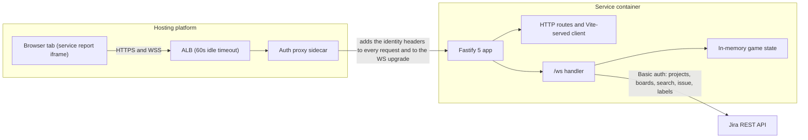
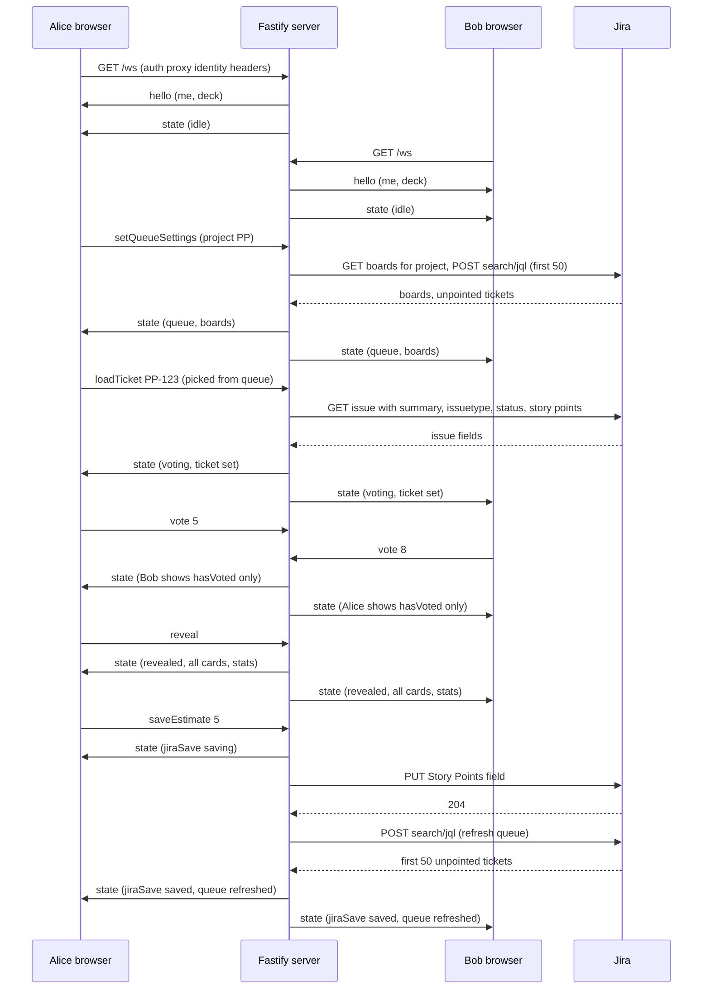

# Pointing Poker: overview

## Context and goal

The engineering team has tried several planning tools and liked none. The ask is a tiny, self-hosted
pointing-poker clone that runs as a service on the hosting platform: load a Jira ticket,
everyone picks a card from a Fibonacci deck, reveal, save the agreed number back to Jira.

Scope for v1: one shared room per instance, no database, no user management, no moderator role,
no observers, no room codes. Jira write-back (Story Points) is in v1.

## Architecture in prose

- One Fastify 5 process serves everything. It serves the client built by Vite, and it serves a
  WebSocket endpoint at `/ws`. In dev, `@fastify/vite` runs Vite inside the same process, so one
  command gives HMR on port 3838. In production, it serves the prebuilt `dist/client`.
- Each browser tab opens one WebSocket. The identity comes from the auth proxy's headers
  (names set by `IDENTITY_USER_ID_HEADER` and `IDENTITY_USERNAME_HEADER`) and is bound to the socket at upgrade. No message body
  carries a user identifier.
- Game state lives in process memory. `server/game.ts` is a pure state machine with no I/O.
  `server/ws.ts` wires it to sockets. Each viewer gets their own snapshot (`viewFor`), so hidden
  votes stay hidden until reveal.
- The ticket queue is a live Jira search, not a database. Queue settings (project and board) are
  shared room state, held in memory with the
  rest of the game. The server runs the search when settings change, when someone refreshes, and
  after each save, then sends the same list to every viewer. The search box sends a separate
  `searchTickets {query}` command. It matches an exact key, or runs `text ~ "query*"`, and returns
  the top 10. The result goes back only to the viewer who searched, as `searchResults`.
- Only `server/jira.ts` talks to Jira. It reads a ticket, lists projects and boards, runs the queue
  search, and writes Story Points, all with the same
  credential. The browser never sees the token.
- The loaded ticket carries its full description and all comments (capped at 50, oldest first) as
  Jira-rendered HTML, plus assignee, priority, and labels. `server/sanitize.ts` cleans that HTML with
  `sanitize-html` before it leaves the server and replaces attachment images with links, so the
  browser never renders raw Jira markup.
- `shared/` holds the protocol types, the deck, and the queue defaults. Client and server both
  import it.
- The client is one React page on MUI. `useGameSocket` owns the connection, reconnects with
  backoff, and keeps the last snapshot while reconnecting. `Layout.tsx` sets LAYOUT C at laptop
  widths: three top panes side by side. The queue and search sit on the left (25%), the ticket
  description in the center (42%: key, summary, meta chips, Jira-rendered description), and the
  comments on the right (33%, oldest first). A one-row sticky bottom bar (88px) holds the
  participant chips with vote status and values, the stats inline after reveal, the deck in the
  middle, and the actions on the right. There is no phone layout.
- Only one replica may run. Two instances would each hold their own rooms.

## Runtime components



## One round, end to end



The heartbeat runs alongside this. The server pings each socket every 25s and terminates any
socket that missed the last pong. That keeps the connection under the ALB's 60s idle timeout.

## Stack (versions = `dist-tags.latest` on 2026-10-15)

| Layer | Choice | Notes |
|---|---|---|
| Runtime | **Node 26** (`node:26-alpine`, which exists) | Node 24 is Active LTS today; 26 was released May 5, 2026 and enters LTS this month. `.node-version` = `26` |
| Language | **TypeScript 7.0.2** (native compiler) | `tsc --noEmit` for type checks only. Server runs via Node's built-in type stripping: no server build step. `erasableSyntaxOnly: true` enforces strippable syntax (no enums, no parameter properties) |
| Server | **Fastify 5.12** + `@fastify/websocket` 11.3 (wraps `ws` 8) + `@fastify/vite` 10 (pulls in `@fastify/static`) | WS handler gets `(socket, request)`: raw `ws` socket + upgrade headers |
| Client | **Vite 8.3** + `@vitejs/plugin-react` 6 + **React 19.3** + **MUI 9.5** (`@mui/material`, `@mui/icons-material`, emotion) | Stock MUI theme with only the font changed. `@fastify/vite` runs Vite in-process in dev and serves `dist/client` in prod |
| Validation | zod | WS message bodies and env |
| Lint + format | **Biome 2.5** | One `biome.json`; `biome ci` in CI, `biome check --write` locally |
| Tests | none in v1 (decision); type checks via tsc, lint via Biome | See `08-decision-log.md` |

Peer ranges checked: `@fastify/vite` wants `vite >=6`, `fastify >=5`;
`@vitejs/plugin-react` 6 wants Vite 8; MUI 9 peers on React 17-19 and emotion (pigment-css optional).

Tests are not part of v1 (decision, see `08-decision-log.md`). See `02-server.md` section 1.

## Repo layout

```
pointing-poker/
  client/                     Vite root (vite.config.ts at repo root sets root: 'client')
    index.html                <div id="root">, <script type="module" src="/src/main.tsx">, Lato <link> (Roboto fallback)
    src/
      main.tsx                createRoot, ThemeProvider + CssBaseline
      theme.ts                createTheme({ typography: { fontFamily: 'Lato, Roboto, sans-serif' } })
      App.tsx                 owns useGameSocket, lays out the page
      useGameSocket.ts        WS client: connect, reconnect w/ backoff, send()
      lib/estimate.ts         suggestPoints(stats, deck): mode of numeric votes, tie -> higher
      components/
        TopBar.tsx            AppBar: app name, Connected/Reconnecting chip, "You are {name}"
        Layout.tsx            LAYOUT C: three top panes (25/42/33) and the one-row sticky bottom bar
        TicketDescription.tsx Display only: key, summary, meta chips, description (sanitized HTML)
        TicketComments.tsx    Display only: comments, oldest first (sanitized HTML)
        QueuePanel.tsx        Project and board selects, queue list, search box, manual key entry (collapsed fallback)
        ParticipantChips.tsx  Chips with vote status (icon before reveal, value after), offline dimmed
        Deck.tsx              row of Buttons, aria-pressed, click selected card = clear vote
        ActionBar.tsx         Reveal | Reset/Next ticket | Story points Select + Save to Jira | stats
        ErrorSnackbar.tsx     Snackbar+Alert keyed on error.id
  server/
    index.ts                  reads env, buildApp(), listen 0.0.0.0:PORT (default 3838), SIGTERM
    app.ts                    buildApp({ jira, heartbeatMs, serveClient = true }): registers plugins + routes, returns the Fastify instance (serveClient: false skips booting Vite)
    routes/health.ts          GET /api/status, GET /api/me
    routes/spa.ts             @fastify/vite registration ({ root, dev, spa: true }), GET / -> reply.html()
    ws.ts                     GET /ws { websocket: true }: origin check, identity, registry, dispatch, per-viewer snapshots, staleness guards
    heartbeat.ts              isAlive ping loop over fastify.websocketServer.clients (25s), terminate on missed pong
    identity.ts               toHeaders(req) + resolveIdentity(req) (auth proxy headers, then dev override)
    game.ts                   pure state machine, no I/O imports
    jira.ts                   createJiraClient({ baseUrl, email, token, fieldOverride, fetch })
    sanitize.ts               Jira HTML to safe HTML (sanitize-html); attachment images to links
    env.ts                    lazy env() parsed with zod (never at module scope)
    log.ts                    thin wrapper over fastify.log (pino) so game/jira modules stay framework-free
    lib/proxy-identity.ts         getProxyIdentity / ProxyIdentity: reads the configured identity headers
  shared/
    protocol.ts               Snapshot, PlayerView, Ticket, ClientCommand, ServerMessage, QueueSettings, QueueItem, JiraProject, JiraBoard, QueueState (types only)
    deck.ts                   DECK = ['0','1','2','3','5','8','13','21','?','☕'], isNumericCard()
    constants.ts              queue defaults shared by client and server
  vite.config.ts              root: 'client', build.outDir '../dist' (viteFastify appends /client), emptyOutDir, plugins: [react(), viteFastify({ spa: true })]
  biome.json                  formatter space/100/double quotes, linter recommended + domains.react, "!!dist"
  tsconfig.base.json          strict, verbatimModuleSyntax, allowImportingTsExtensions, erasableSyntaxOnly, noEmit, skipLibCheck
  tsconfig.json               client + shared: jsx react-jsx, lib DOM, moduleResolution bundler, types ["vite/client"]
  tsconfig.server.json        server + shared: module nodenext, types ["node"]
  Dockerfile, .dockerignore, .node-version (26), .github/workflows/ci.yml
  docs/deploy.md, CLAUDE.md, README.md, .env.example, .gitignore, package.json, package-lock.json
```

Client and server import `shared/` by relative path with explicit `.ts` extensions (required by
Node type stripping; `allowImportingTsExtensions` makes tsc accept them; Vite handles them too).

Note: the tree above is the plan's layout. Test files and `vitest.config.ts` are left out (no tests in v1).

## Glossary

| Term | Meaning |
|---|---|
| Auth proxy | The hosting platform's proxy sidecar in front of each service. It adds the identity headers (names set by `IDENTITY_USER_ID_HEADER` and `IDENTITY_USERNAME_HEADER`) and proxies WebSocket upgrades |
| Platform service | A container that the hosting platform runs from a container image. Its settings (port, health path, proxy timeouts, replicas, credentials, env vars) are set on the service. Replicas default to 1 (verified against the platform's source during planning) |
| Service report | The published page in the hosting platform where people open a service. Identity headers arrive only when a request goes through the platform |
| Story Points field | The Jira custom field the app writes. Found by name "Story Points" (fallback "Story point estimate"), unless `JIRA_STORY_POINTS_FIELD` is set. The plan confirmed a field named "Story Points" exists in the team's main project |
| Deck | The fixed card list in `shared/deck.ts`: `0, 1, 2, 3, 5, 8, 13, 21, ?, coffee`. Numeric cards feed the stats and the Save value |
| Round | One estimate on one ticket. `loadTicket` starts a new round and bumps the `round` counter. `reset` replays voting on the same ticket |
| Snapshot | The full state object sent to one viewer in each `state` message. Built per viewer by `viewFor` |
| Phase | `idle`, `voting`, or `revealed`. Votes are visible only in `revealed` |
| Queue | The shared list of unpointed Jira tickets the picker shows: not Done, Story Points empty, first 50 by Rank. Each refresh runs a JQL search. Nothing is stored |
| Needs pointing | A ticket needs pointing when its status is not in Jira's Done category and its Story Points field is empty. Labels play no part (decision 34) |
| Board filter | The filter behind a Jira board, read from the board's configuration. With a board selected, the queue JQL adds `filter = <id>` so it matches that board's scope. With no board, the search covers the whole project |
| Sanitized HTML | Jira's rendered HTML for a ticket's description and comments. `server/sanitize.ts` strips unsafe tags and attributes with `sanitize-html`, and replaces attachment images with links, before the ticket reaches the browser |
